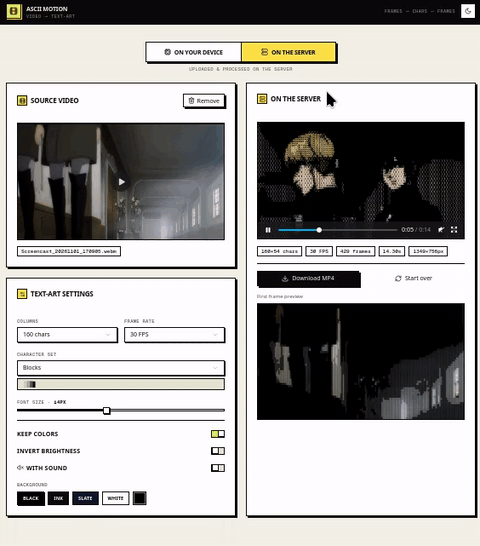

# ASCII Motion — Video → ASCII Art Converter

Convert any video into animated ASCII art. Built with Next.js 16, React 19,
@napi-rs/canvas, ffmpeg, and Tailwind CSS. Real-time preview, client-side and
server-side conversion modes, customizable character ramps, colors, and FPS.



> 🎬 **Live demo above** — upload a video, pick your ASCII settings, watch it
> convert in real-time, then download the result as an MP4.

## Features

- **Video → ASCII conversion** — upload any mp4/webm/mov, get back an ASCII art video
- **Dual mode** — client-side (in-browser canvas) or server-side (ffmpeg + native canvas)
- **Live preview** — see the ASCII output as it converts, frame by frame
- **Customizable** — choose character ramp, columns (80–240), FPS (12–60), background color
- **Audio support** — optionally keep the original audio track in the output
- **Download result** — get the final mp4 with ASCII frames
- **Dark/light theme** — toggle with one click
- **Brutalist UI** — sharp borders, bold typography, no rounded corners

## Tech Stack

| Layer       | Choice                              | Why                                      |
|-------------|-------------------------------------|------------------------------------------|
| Framework   | Next.js 16 (App Router)             | Server + client in one, API routes       |
| Language    | TypeScript 5                        | End-to-end typed                          |
| Rendering   | @napi-rs/canvas                      | Native canvas, no browser needed (server) |
| Video       | ffmpeg / ffprobe                     | Fast frame extraction + encoding          |
| UI          | Tailwind CSS + shadcn/ui            | Brutalist design system                   |
| Animations  | Framer Motion                       | Smooth transitions                        |
| Database    | Prisma + SQLite                     | Job queue (optional, for server mode)     |

## How it works

### Client mode (default)
1. User uploads a video → loaded into a `<video>` element
2. Frames are extracted to a `<canvas>` at the chosen FPS
3. Each frame's pixels are mapped to ASCII characters based on brightness
4. The ASCII grid is rendered to a second canvas → streamed to a video preview

### Server mode (for large files)
1. Upload is saved to disk → job created in Prisma DB
2. A Node worker spawns ffmpeg to extract frames
3. A glyph atlas is pre-rendered (each character → RGBA pixels)
4. Each frame is mapped to chars → composited into a raw RGBA buffer
5. ffmpeg encodes the RGBA buffer → mp4 (with optional audio)
6. Client polls `/api/ascii/status` → downloads the result when done

## Quick Start

```bash
# 1. Install dependencies
bun install   # or npm install

# 2. Set up the database
cp .env.example .env
bun run db:generate
bun run db:push

# 3. Install ffmpeg (required for server-side conversion)
sudo apt install ffmpeg   # Linux
brew install ffmpeg        # macOS

# 4. Start the dev server
bun run dev
```

Open http://localhost:3000 → upload a video → convert.

## Build for Production

```bash
bun run build
bun run start
```

## Project Structure

```
ascii-motion/
├── prisma/schema.prisma             # User + Post models (Prisma)
├── src/
│   ├── app/
│   │   ├── api/ascii/
│   │   │   ├── convert/route.ts     # POST: upload + start conversion job
│   │   │   ├── status/route.ts      # GET: poll job status
│   │   │   ├── result/route.ts      # GET: download finished mp4
│   │   │   └── preview/route.ts     # GET: stream preview frames
│   │   ├── layout.tsx               # Root layout + theme provider
│   │   ├── page.tsx                 # Home — the converter UI
│   │   └── globals.css              # Tailwind + brutalist theme vars
│   ├── components/
│   │   ├── video-converter.tsx      # Main converter component
│   │   ├── ascii-client-output.tsx  # Client-side ASCII renderer
│   │   ├── ascii-server-output.tsx  # Server-side ASCII renderer
│   │   ├── theme-toggle.tsx         # Dark/light toggle
│   │   └── ui/                      # shadcn/ui components
│   └── lib/
│       ├── ascii-engine.mjs         # Server-side ffmpeg pipeline
│       ├── ascii-worker.mjs         # Node worker for conversion
│       ├── ascii-jobs.ts            # Job queue (Prisma-backed)
│       ├── video-ascii.ts           # Char ramps + types
│       └── db.ts                    # Prisma client singleton
├── public/                          # Static assets
├── .env.example                     # Copy to .env, set DATABASE_URL
└── package.json
```

## Requirements

- **Node.js 20+** or **Bun** (recommended)
- **ffmpeg + ffprobe** installed and on PATH (for server-side conversion)
- Linux/macOS/Windows — works everywhere

## Configuration

### Environment variables (`.env`)

```
DATABASE_URL="file:./dev.db"
```

The database is SQLite — a single file. No external DB server needed.

### Character ramps

The app ships with several ASCII character ramps (from lightest to darkest):

- ` .:-=+*#%@` — classic
- ` .'`^\",:;Il!i><~+_-?][}{1)(|/tfjrxnuvczXYUJCLQ0OZmwqpdbkhao*#WMB8&%$`
- ` ░▒▓█` — block characters
- Custom — define your own in `src/lib/video-ascii.ts`

## License

MIT — do whatever you want.

## Credits

Built by [sudaisalamboy](https://github.com/sudaisalamboy).
Inspired by the classic "ASCII art generators" but with video support + real-time preview.
